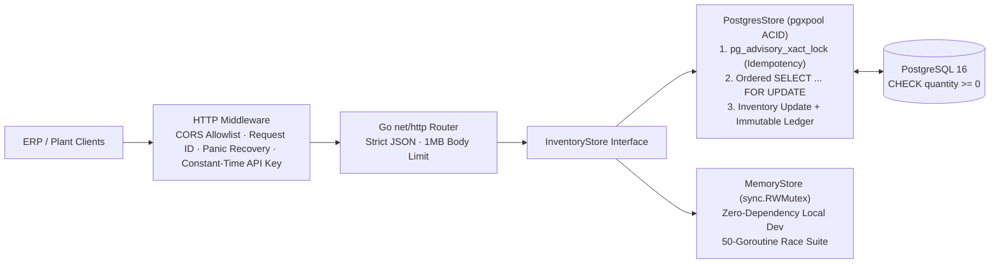

# ERP Inventory Microservice (Go)

[](https://github.com/ankit5841/erp-inventory-service/actions/workflows/ci.yml)


Idiomatic Go microservice for real-time chemical and dye inventory tracking, atomic inter-plant transfers, and immutable ledger auditing across **23 manufacturing units**, hardened with optimistic locking, PostgreSQL advisory-locked idempotency, and race-tested concurrency controls.

> **Portfolio Note:** Clean-room reference implementation built with synthetic plant and SKU data to demonstrate Go microservice, concurrency, and transactional PostgreSQL architecture patterns for multi-plant chemical ERP systems. No proprietary company code or live factory data is included.

## Architecture



## Concurrency & Data Consistency Guarantees

| Failure Mode | Protection Mechanism | Behavior |
| :--- | :--- | :--- |
| **Lost updates / stale writes** | Optimistic locking (`expected_version`) | Returns `409 Conflict` if another plant transaction modified the SKU first |
| **Duplicate retries / network storms** | `Idempotency-Key` serialized via `pg_advisory_xact_lock` + operation check | Concurrent identical retries replay safely (`idempotent_replay: true`); cross-endpoint key reuse returns `409 Conflict` |
| **Bidirectional transfer deadlocks** | Deterministic `SELECT ... FOR UPDATE` row locking sorted by `plant_id` | Prevents circular lock waits when `PLANT-A -> PLANT-B` and `PLANT-B -> PLANT-A` run simultaneously |
| **Overselling / negative stock** | Atomic balance verification + PostgreSQL `CHECK (quantity_kg >= 0)` | Rejects overdrafts with `422 Unprocessable Entity` |
| **Handler panics & timing attacks** | Stack-logged panic recovery middleware + `crypto/subtle.ConstantTimeCompare` | Returns clean JSON `500` with `X-Request-ID`; prevents API key timing leaks |

## 23-Plant Domain Model

| Plant Units | Manufacturing Block | Primary Material Lines |
| :--- | :--- | :--- |
| `PLANT-01` – `PLANT-09` | Disperse Block | Disperse Dyes, Dispersing Agent NNO |
| `PLANT-10` – `PLANT-15` | Reactive Block | Reactive Dyes |
| `PLANT-16` – `PLANT-19` | Backward Integration — Intermediates | Vinyl Sulphone, H-Acid |
| `PLANT-20` – `PLANT-21` | Backward Integration — Crude | Crude Disperse & Reactive Presscakes |
| `PLANT-22` – `PLANT-23` | Auxiliaries & Formulation | In-House Dispersing Agents (NNO, MF) |

## API Endpoints

| Method | Endpoint | Purpose |
| :--- | :--- | :--- |
| `GET` | `/health` | Service and storage readiness check |
| `GET` | `/api/v1/overview` | Aggregated stock tonnage and alerts across all 23 units |
| `GET` | `/api/v1/plants` | List all 23 manufacturing units |
| `GET` | `/api/v1/plants/{plantID}/inventory` | Plant stock list (supports `?low_stock=true`) |
| `GET` | `/api/v1/plants/{plantID}/inventory/{sku}` | Single SKU balance and lock version |
| `GET` | `/api/v1/alerts/low-stock` | Network-wide below-reorder alerts across all 23 units |
| `GET` | `/api/v1/inventory/sku/{sku}` | Cross-plant SKU locator and total network tonnage |
| `POST` | `/api/v1/plants/{plantID}/inventory/{sku}/adjust` | Optimistic-locked, idempotent stock adjustment |
| `POST` | `/api/v1/transfers` | Atomic, deadlock-free inter-plant stock transfer |
| `GET` | `/api/v1/ledger` | Immutable stock movement audit trail (`?plant_id=&limit=`) |

## Engineering Trade-offs & Production Notes

* **Real PostgreSQL 16 CI Verification:** GitHub Actions spins up a live `postgres:16-alpine` service container and runs `go test -v -race ./...` across 13 tests—including a 10-goroutine simultaneous idempotency storm and a 20-goroutine `FOR UPDATE` stock-deduction race.
* **Quantity representation (`float64` vs. integer grams):** Quantities use `float64` rounded to gram precision (`0.001 kg`) for readability; in a high-frequency financial/ERP deployment, migrating to `int64` milligrams or PostgreSQL `NUMERIC(12,3)` eliminates binary floating-point drift.
* **Schema bootstrapping vs. migration runner:** `NewPostgresStore` applies `migrations/001_init.sql` semantics on startup for one-command `docker compose up` demos; production rollouts should decouple schema evolution via `golang-migrate` or `goose` and restrict auth to plant-scoped JWT/RBAC claims.

## Quick Start

```bash
# Local tests and server (in-memory 23-plant store)
go vet ./...
go test -v ./...
go run ./cmd/server

# Full stack (Go microservice + PostgreSQL 16)
docker compose up --build
```